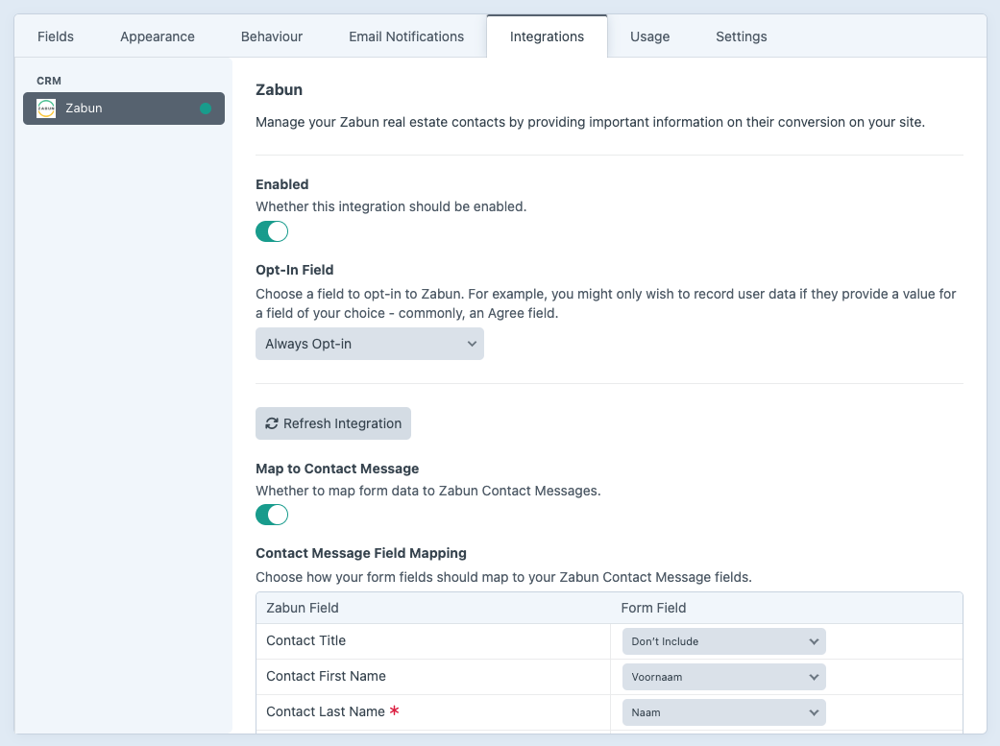

# Formie Zabun Integration

[](https://packagist.org/packages/esign/craft-formie-zabun)
[](https://packagist.org/packages/esign/craft-formie-zabun)

<p align="center"></p>

A [Zabun](https://zabun.be) integration that extends the [Formie](https://verbb.io/craft-plugins/formie/features) plugin for Craft CMS.

## Requirements

This plugin requires:
- Craft CMS 5.0.0 or later
- PHP 8.2 or later
- Formie 3.0 or later
- A Zabun account

## Installation

You can install this plugin from the Plugin Store or with Composer.

### From the Plugin Store

Go to the Plugin Store in your project’s Control Panel and search for “Formie Zabun Integration”. Then press “Install”.

### With Composer

Open your terminal and run the following commands:

```bash
# go to the project directory
cd /path/to/my-project.test

# tell Composer to load the plugin
composer require esign/craft-formie-zabun

# tell Craft to install the plugin
./craft plugin/install formie-zabun
```

## Usage

### Setting Up the Zabun Integration

1. Navigate to Formie > Settings > CRM
2. Click "new integration"
3. Select 'Zabun' as your integration provider
4. Enter your Zabun credentials and save the integration
5. After saving, click the refresh button to verify the API connection

### Sending Form Submissions to Zabun

1. Go to the form you want to connect with Zabun
2. Navigate to the Integrations tab
3. Enable your Zabun integration
4. Map your form fields:
   - Map to Contact Message for user messages
   - Map to Contact Request for user property requests
5. Map each field carefully, be sure to configure your form fields to match the accepted [content types](https://gateway-cmsapi.v2.zabun.be/swagger/index.html?urls.primaryName=Zabun+1+CmsApi+-+v1)

### Zabun 360

Agencies on Zabun 360 (Skarabee WebLink) use the **Zabun 360** integration instead. Every submission becomes a
"contact me" request in the agency's account (`POST v1/contactmes`).

1. Navigate to Formie > Settings > CRM and add a **Zabun 360** integration.
2. Enter the agency's WebLink API key (the same key the property sync uses), e.g. `$IMMO_API_KEY`.
3. Set **Enabled** to an environment variable, e.g. `$IMMO_SEND_LEADS`, and switch it on for the live site only:
   staging and local would otherwise create leads in the agency's real account.
4. On each form, enable the integration, switch on **Map to Contact Request** and map the fields. To link a lead to a
   listing, map **Publication ID** to a field holding the listing's Zabun 360 publication ID.

WebLink has no search profiles. Switch on **Add other fields to the comments** to send the fields that aren't mapped
(search preferences, for example) as "Label: value" lines in the comments, after the form's name.

Map **Zip Code** and **City** to the same field and fill them from a `ModifyFieldIntegrationValueEvent`
(`Zabun360::EVENT_MODIFY_FIELD_MAPPING_VALUE`): its `integrationField->handle` says which of the two it is.

A refused contact or an HTTP error fails the integration's queue job (the log names the submission, not the lead's
details). Each contact carries the submission's UID as `externalReference`; whether WebLink ignores a repeated one
isn't known, so retrying a job that failed after WebLink received the contact may create a duplicate lead.

## API Documentation

For more information about the Zabun API, refer to the [Zabun API documentation](https://gateway-cmsapi.v2.zabun.be/swagger/index.html?urls.primaryName=Zabun+1+CmsApi+-+v1).

## License

This plugin is licensed under the MIT License. Please see [License File](LICENSE.md) for more information.

## Screenshot

